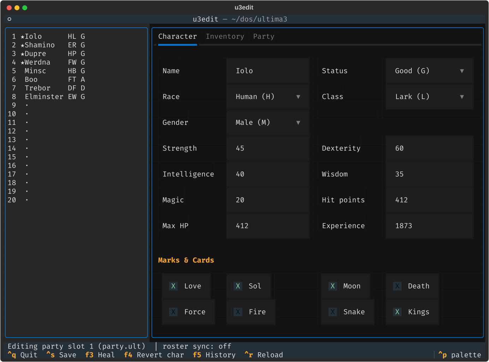
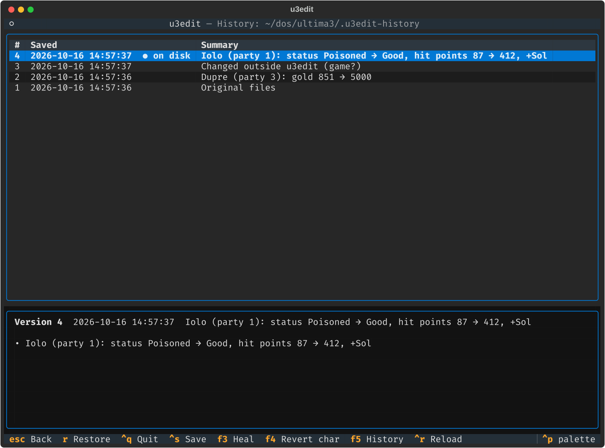
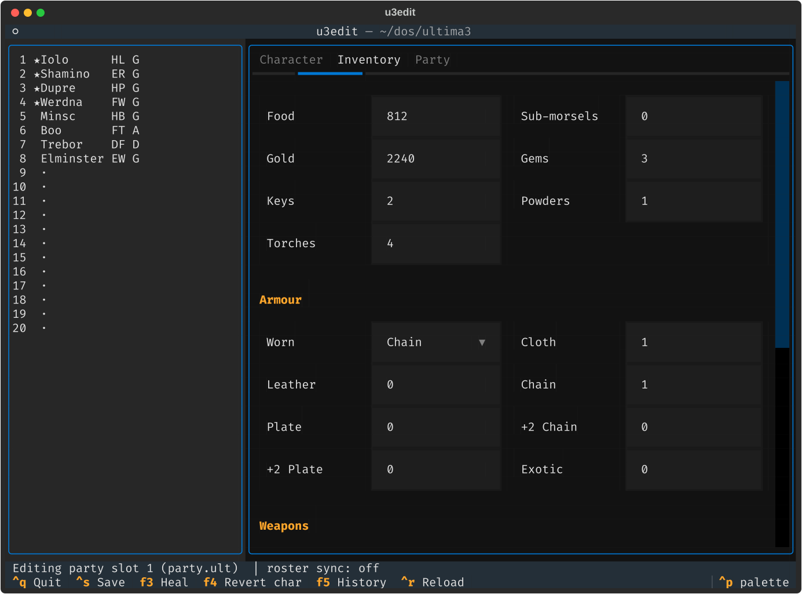
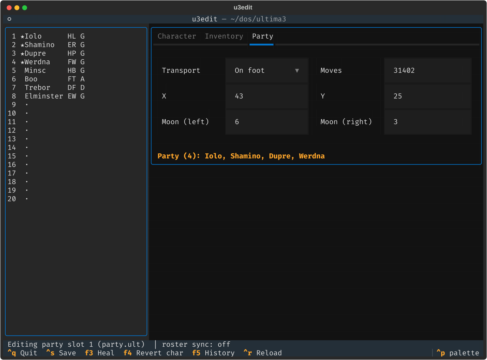
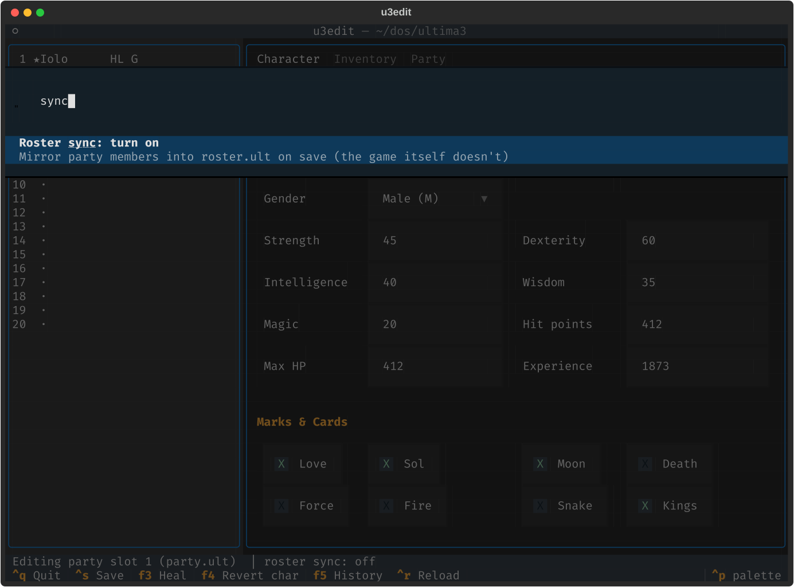

# u3edit

**A savegame editor for _Ultima III: Exodus_ that runs right in your terminal.**

No Windows. No Wine. No 1990s shareware installer. Point it at your DOS game directory,
fix your party and get back to hunting Exodus.



## Why u3edit?

- **Runs anywhere Python runs.** Linux, macOS, Windows, over SSH, next to your DOSBox window.
- **A real TUI, not a hex editor.** Dropdowns for race, class and status, validated number
  fields, checkboxes for the marks and cards. Invalid values turn red and are never written.
- **Every save is a version you can go back to.** A full, compressed history with
  human-readable change logs, restorable with two keystrokes. See below.
- **Works with the game, not against it.** u3edit understands how Ultima III keeps the
  active party in `PARTY.ULT`, and it won't overwrite progress the game saved while the
  editor was open.
- **Byte-exact.** Only the fields you touch change. Unknown bytes survive untouched, so
  your files stay 100 % compatible with the original game.

## ⏳ The version history

This is the feature to know about. Experimenting with a 40-year-old save format is risky,
and the history makes it safe:



- **Every save creates a version**, stored as a tiny bzip2 tarball (about 1.4 KB) in
  `.u3edit-history/` next to your save files.
- **Your untouched originals are always version 1.** The very first save records them
  before anything is written.
- **Game progress is captured too.** If the game saved since the last version (you played
  a round in DOSBox with the editor still open), u3edit notices. It records that state as
  *"Changed outside u3edit"* before writing, and merges your edits on top of it field by
  field. Your moves, food and position from the game are kept, and your edits still apply.
- **Readable change logs.** Every version lists exactly what changed:
  `Iolo (party 1): status Poisoned → Good, hit points 87 → 412, +Sol`,
  `Dupre (party 3): gold 851 → 5000`, `Party moves: 31337 → 31402`.
  You never have to diff hex dumps.
- **Restore any version** with `F5` → select → `r` (or `Enter`). The restore is itself
  recorded as a new version, so even a restore can be undone.
- **No lock-in.** The versions are plain tarballs: `tar -xjf 0003-*.tar.bz2` gets your files
  back without u3edit.
- **The version on disk is marked** with `● on disk`, so you always know where you stand.

## Features

| Character | Inventory | Party |
|---|---|---|
|  |  |  |

- **Characters:** name, status (Good / Poisoned / Dead / Ashes), race, class, gender,
  Strength, Dexterity, Intelligence, Wisdom, MP, HP, max HP, experience
- **Marks & cards:** Love, Sol, Moon, Death, Force, Fire, Snake, Kings
- **Inventory:** food (and sub-morsels), gold, gems, keys, powders, torches, all 7 armour
  and 15 weapon types, plus what is worn or readied
- **Party:** transport (foot, horse, ship), move counter, map position, both moon phases
- **One-key heal (`F3`):** sets the status back to Good (curing poison, death and ashes)
  and HP to max HP
- **Per-character revert (`F4`):** throw away the edits to one character and keep the rest
- **Hot reload while playing (`Ctrl+R`):** save in DOSBox, hit `Ctrl+R`, and the editor shows
  the new state, with a notification of what changed. If you have unsaved edits, you choose:
  keep them on top of the new files, or discard them. Every reload that brings new game
  progress also adds a history version, so your play session leaves a trail you can rewind.
- **Command palette (`Ctrl+P`):** every action, searchable



## Installation

Requires Python ≥ 3.10 and [uv](https://docs.astral.sh/uv/).

```sh
git clone <this repo> u3edit
cd u3edit
uv run u3edit ~/dos/ultima3
```

Or install it as a tool: `uv tool install .` and run `u3edit` from anywhere.

## Usage

```sh
u3edit /path/to/ultima3            # open the TUI
u3edit --dump /path/to/ultima3     # print all characters and exit
u3edit --sync-roster /path/...     # start with roster sync enabled
```

The directory must contain `ROSTER.ULT` and `PARTY.ULT`. `SOSARIA.ULT` (moon phases) is
optional. File-name case doesn't matter.

| Key | Action |
|---|---|
| `↑` / `↓` | select a roster slot (★ = member of the active party) |
| `Tab` | next field |
| `Ctrl+S` / `F2` | save (creates a history version) |
| `F3` | heal the selected character |
| `F4` | revert the selected character to the file contents |
| `F5` | version history |
| `Ctrl+R` / `F6` | reload from disk (pick up what the game just saved) |
| `Ctrl+P` | command palette, incl. *Roster sync: turn on/off* and *History* |
| `Ctrl+Q` | quit (asks first if there are unsaved changes) |

### Party members and roster sync

While a party is formed, Ultima III works on the copies in `PARTY.ULT`. When it saves, it
writes only that file, so `ROSTER.ULT` stays stale. u3edit follows the game: selecting a
party member (★) edits the `PARTY.ULT` record, and by default only that file is written.

If you want the roster to show the same data, turn on **roster sync** (`Ctrl+P` or
`--sync-roster`). Saving then copies the party records into their roster slots. The
status bar always shows the current setting.

## File format (DOS version)

All numbers are BCD, stored **little-endian** (HP 150 = `50 01`), unlike the Apple II
original.

Character record, 64 bytes (`ROSTER.ULT` = 20 records; `PARTY.ULT` = 18-byte header + 4 records):

| Off | Size | Field |
|---|---|---|
| 00 | 10 | name, NUL-padded |
| 0E | 1 | marks/cards bits: Love, Sol, Moon, Death, Force, Fire, Snake, Kings (bit 0..7) |
| 0F | 1 | torches |
| 10 | 1 | `FF` = in party |
| 11 | 1 | status `G P D A` |
| 12-15 | 4 | Str Dex Int Wis |
| 16/17/18 | 1 | race / class / gender letter |
| 19 | 1 | MP |
| 1A/1C/1E | 2 | HP / max HP / exp |
| 20 | 1 | sub-morsels |
| 21/23 | 2 | food / gold |
| 25-27 | 1 | gems, keys, powders |
| 28 | 1 | worn armour index, then 29-2F armour counts |
| 30 | 1 | readied weapon index, then 31-3F weapon counts |

Party header: `00` transport (`3F` foot, `0A` horse, `0B` ship), `03` moves (4 bytes),
`07` party size, `08/09` x/y, `0A` roster numbers (1-based) of the party slots.
Moons: `SOSARIA.ULT` offset `0x1224` (left/right phase 0-7).

Sources: [Ultima Codex: Ultima III internal formats](https://wiki.ultimacodex.com/wiki/Ultima_III_internal_formats),
verified against real DOS saves (`tests/fixtures`).

The screenshots show the demo party from `tests/fixtures/demo`: Iolo, Shamino, Dupre and
Werdna adventuring together while Minsc waits in the roster, Elminster minds his own
business, Trebor is dead and Boo, sadly, is ashes.

## Development

```sh
uv run pytest
uv run python scripts/make_demo.py     # rebuild the demo save
uv run python scripts/screenshots.py   # re-render docs/screenshots (needs inkscape)
```

The tests include headless TUI runs (edit → save → history → restore, plus the case where
the game saves while the editor is open). They only ever touch temporary copies of the
fixtures.

## License

[MIT](LICENSE) © 2026 Mathias Menzel-Nielsen
